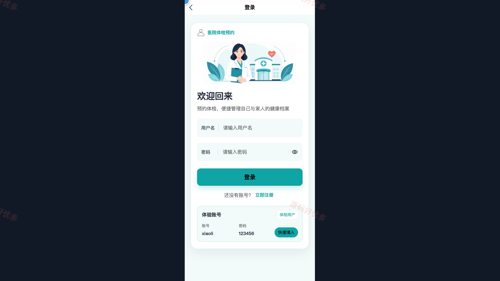
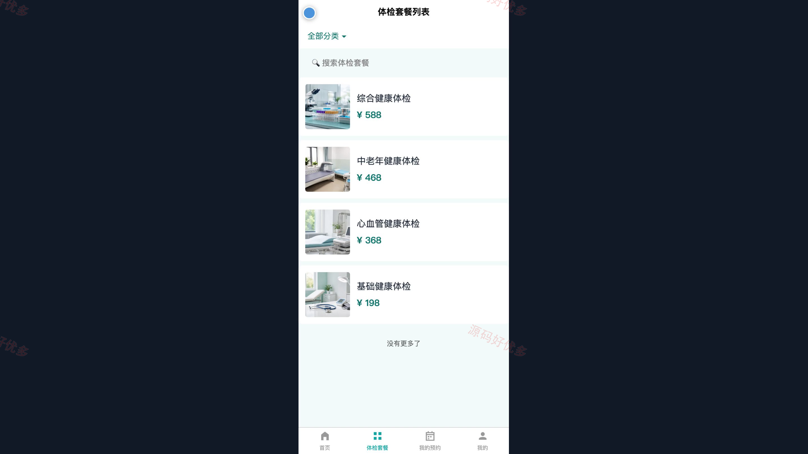
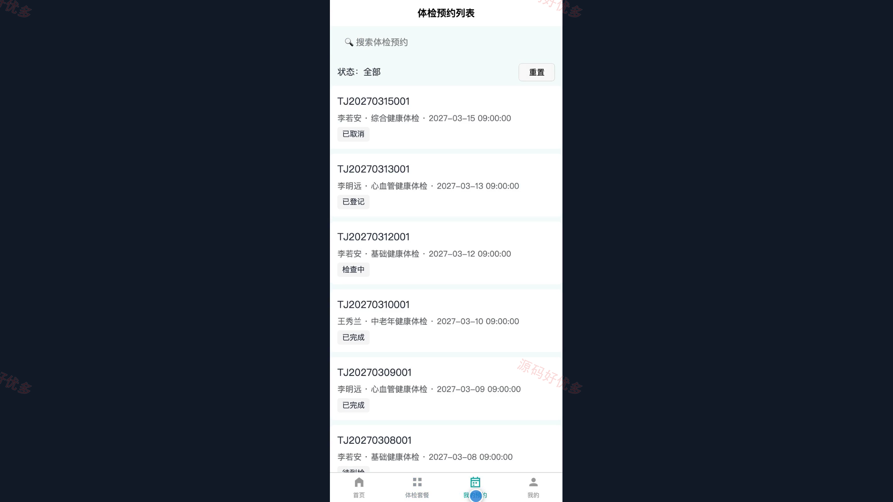
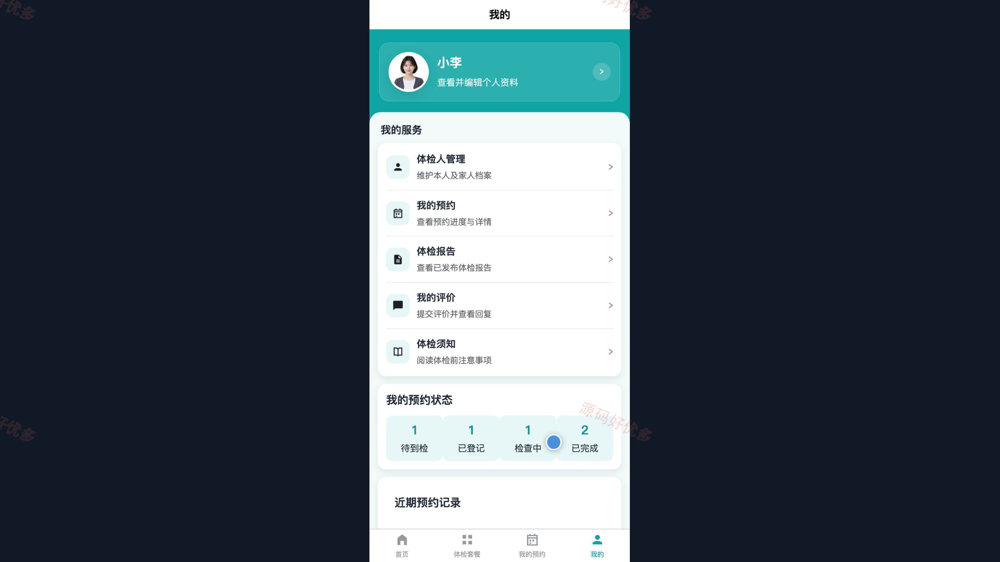
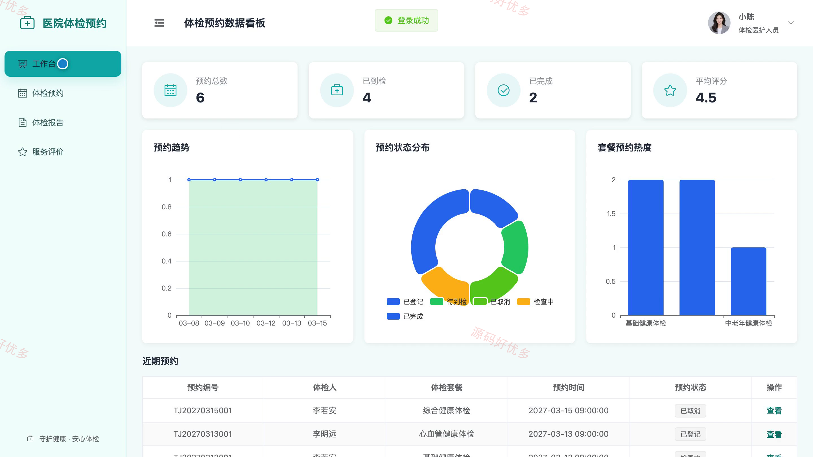
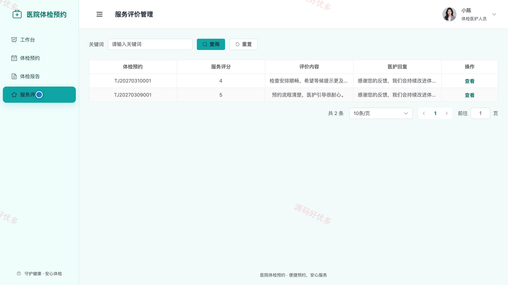
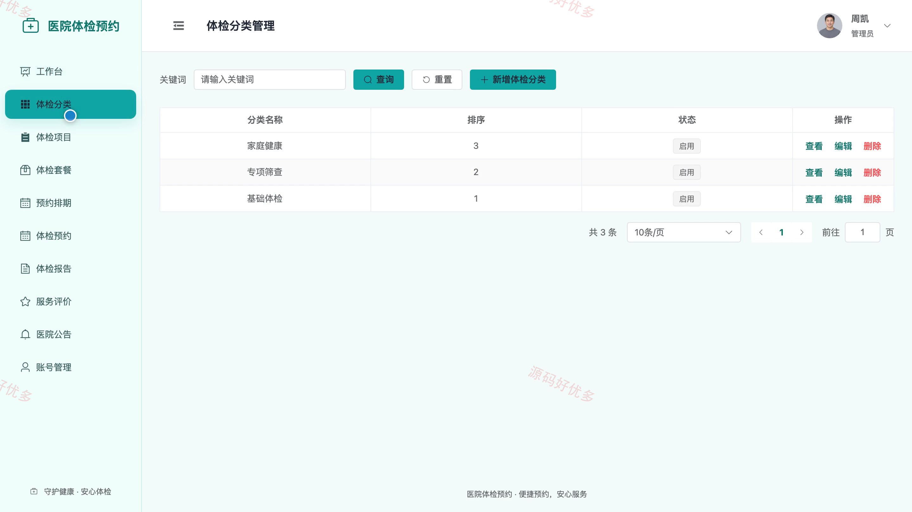

## 源码问题查看主页咨询

### 一、关键词
健康体检预约、体检套餐服务、预约排期、体检报告、健康检查服务

### 二、作品包含
源码+数据库+万字设计文档+PPT+全套环境和工具资源+本地部署教程

### 三、项目技术
前端技术： Html、Css、Js、Vue3.4、Element-Plus、uniapp
后端技术：Java、SpringBoot3.2.0、MyBatis-Plus

### 四、运行环境要求
开发工具：IDEA/eclipse + VSCODE + HBuilder X + 微信开发者工具

数据库：MySQL5.7+（共14张表）

数据库管理工具：Navicat10以上版本

环境配置软件： JDK17 + Maven3.6

前端Nodejs：16+

浏览器：谷歌浏览器

### 五、项目介绍
项目编号：bs059B

本项目面向医院健康体检业务，体检用户可在微信小程序中维护体检人档案、浏览体检套餐、选择排期提交预约并跟踪体检进度与报告；体检医护人员在管理端处理分配给本人的预约、登记到检、录入检查结果、发布报告并回复评价；管理员负责账号、分类、项目、套餐、排期、预约调度、公告、报告和统计管理。

角色：用户、体检医护人员、管理员

用户功能：注册登录与个人资料维护、体检人档案管理、体检套餐分类浏览、在线预约与到检前取消、预约状态与体检进度查询、体检报告查看、服务评价提交与回复查看、医院公告与体检须知查看。

体检医护人员功能：账号登录与密码修改、本人预约查询与到检登记、检查结果录入、体检进度更新、体检报告发布与修正、服务评价查看与回复、体检预约数据看板。

管理员功能：用户与医护账号管理、体检分类与项目管理、体检套餐管理、预约排期与接待名额管理、预约调度与异常取消、体检报告发布监管、医院公告与体检须知管理、服务评价与预约数据统计。

### 六、运行截图

